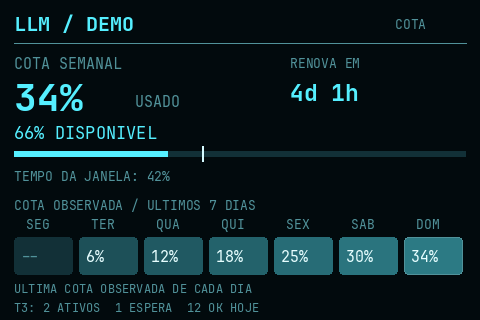
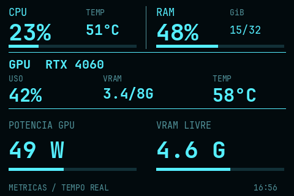
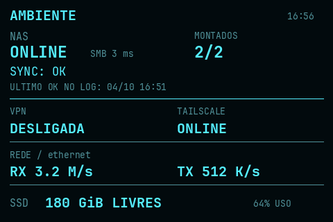

# TURZX Metrics — Hardware & LLM Monitor

A local Linux monitor for a **TURZX/Turing 3.5-inch USB display**, with a clean black/cyan layout and three rotating screens. The UI labels are currently in Portuguese.

| LLM quota & history | Hardware metrics | Environment |
| --- | --- | --- |
|  |  |  |

**All screenshots above use fictional demo data.** Runtime settings, account credentials, logs and quota history stay on the computer.

## Supported hardware

Tested on Linux with the following device identification:

| Property | Tested value |
| --- | --- |
| Display | TURZX/Turing 3.5-inch, 480×320 landscape |
| USB VID:PID | `1a86:5722` |
| Firmware serial identifier | `USB35INCHIPSV2` |
| Protocol | Rev A, RGB565 |
| Connection | Linux CDC ACM (`/dev/ttyACM*`) |

**Screen size alone does not imply compatibility.** This implementation only opens devices matching the identification above. Other revisions, other USB protocols, HDMI screens and SPI displays need different drivers. Compatible units matching these identifiers may work, but only the device described above has been tested. Multiple matching displays are rejected to avoid selecting the wrong device.

The application uses the existing Linux serial driver. It does not install a kernel module or modify display firmware. The original Turing variant may not reply to HELLO; that is accepted only after the exact USB identification check.

## The three screens

- **LLM:** used/available plan quota, reset countdown, quota bar, elapsed-window marker and seven-day history. Optional T3 counters show active turns, threads waiting for input/approval and completed turns today.
- **Hardware:** CPU utilization/package temperature, RAM usage, NVIDIA GPU utilization/temperature/VRAM, GPU power draw and free VRAM.
- **Environment:** optional NAS/SMB reachability and latency, mounted shares, sync state, last complete sync, VPN and Tailscale status, network RX/TX and disk space.

Pages rotate every 12 seconds by default. If several quotas exist, the LLM screen changes quota on the next cycle; the total remains three screens. Hardware/network update every 2 seconds, environment services every 30 seconds and LLM quota every 60 seconds.

The supported GPU reader uses `nvidia-smi`. CPU package temperature currently uses the Intel `coretemp` sensor. Unsupported/missing sensors render as unavailable; AMD GPU support has not been implemented.

## Installation

Requires Linux and Python **3.11 or newer**; tested with Python 3.12. NVIDIA metrics require a working driver and `nvidia-smi`. Other screens can run without it. No Omarchy installation is required.

```sh
git clone https://github.com/ikaromm/turzx-metrics.git
cd turzx-metrics
python3 -m venv .venv
.venv/bin/python -m pip install -r requirements.txt
mkdir -p ~/.config/turzx-metrics
# Run this copy only if you do not already have a configuration:
cp config.example.toml ~/.config/turzx-metrics/config.toml
chmod 600 ~/.config/turzx-metrics/config.toml
```

Edit the local TOML before enabling optional integrations. The example has LLM, NAS, sync, VPN, Tailscale and T3 collection **disabled**. Set `network_interface` to the physical interface from `ip -br link` to enable network rates. If the screen is upside down, use `orientation = "reverse_landscape"`.

The renderer tries installed monospace fonts (DejaVu Sans Mono or JetBrains Mono Nerd Font), then falls back to Pillow's built-in font. To preserve a particular layout, set `regular_font` and `bold_font` to local font paths. No font files are bundled.

### USB access

For a local desktop session, the provided rule grants access only to the matching display through `uaccess`:

```sh
sudo install -m 0644 examples/70-turzx-metrics.rules /etc/udev/rules.d/70-turzx-metrics.rules
sudo udevadm control --reload-rules
```

Reconnect the USB display after installing the rule. If an existing rule is already configured, review it before replacing it. Headless sessions may need a distribution-specific serial group rule instead of `uaccess`. Do not run the monitor as root.

```sh
.venv/bin/python monitor.py
```

### User service

```sh
.venv/bin/python install_user_service.py --dry-run
.venv/bin/python install_user_service.py
systemctl --user daemon-reload
systemctl --user enable --now turzx-metrics.service
```

The installer generates absolute paths for the current checkout and creates the example configuration only if none exists. It refuses to replace an existing service without `--force`. It neither installs the udev rule nor starts the service itself. The reference unit is in `examples/turzx-metrics.service`; rerun the installer if the checkout moves.

```sh
systemctl --user restart turzx-metrics.service
systemctl --user stop turzx-metrics.service
journalctl --user -u turzx-metrics.service -n 30
```

Normal shutdown turns off the backlight. A failed connection is retried by systemd. Physical reconnection and reboot behavior have not yet been verified; the initial connection, orientation correction and repeated page transmissions have been tested.

## Configuration and integrations

Default config: `~/.config/turzx-metrics/config.toml`. Use `--config PATH` for a different file. An explicitly supplied missing file is an error. Restart the service after editing configuration.

| Setting | Purpose / minimum |
| --- | --- |
| `brightness` | 0–100 |
| `orientation` | `landscape` or `reverse_landscape` |
| `interval` | Hardware/network sampling, ≥1 second |
| `page_interval` | Time per screen, ≥5 seconds |
| `llm_interval` | Quota reader, ≥60 seconds |
| `environment_interval` | Environment probes, ≥15 seconds |
| `network_interface` | Physical interface; empty disables rates |
| `disk_path` | Filesystem to monitor, defaults to home |

See [the example config](config.example.toml) and [integration contracts](docs/integrations.md) for optional collectors. Commands are argument arrays executed without a shell. Account setup belongs to the external quota reader; no credentials are stored in this repository.

## History and metric meaning

The seven-day display shows the **last observed quota percentage of each local calendar day**, not tokens consumed that day. Missing days remain `--`; a quota reset may reduce the next value. Quota percentages represent plan usage, not financial cost or token counts.

Only fresh successful readings feed history. Their original timestamp determines the local day. `~/.local/state/turzx-metrics/history.sqlite3` keeps quota identifiers, percentages and timestamps for the last 30 days plus today, with permissions `0600`. It is created only when LLM collection is enabled.

`NAS ONLINE` means the configured SMB port answered; it does not verify pool/disk health or mounted shares. Mount counts are separate. Sync is deferred if the required remote mount is absent, even if a wrapper script exits zero. Only a Unison summary with zero skipped/failed items advances the last OK date. The monitor never mounts shares or starts synchronization.

Network rates use one configured interface to avoid counting VPN traffic twice. K/M rates use base 1024 and are bytes per second. Disk and VRAM capacity values use GiB.

## Previews and tests

Fictional previews do not query hardware, accounts, databases or USB and do not create quota history:

```sh
.venv/bin/python monitor.py --config config.example.toml --demo --page llm --preview demo-llm.png
.venv/bin/python monitor.py --config config.example.toml --demo --page hardware --preview demo-hardware.png
.venv/bin/python monitor.py --config config.example.toml --demo --page environment --preview demo-environment.png
```

Real-data previews do not open USB, but do consult the enabled collectors:

```sh
.venv/bin/python monitor.py --page hardware --preview preview.png
.venv/bin/python monitor.py --page llm --preview preview-llm.png
.venv/bin/python monitor.py --page environment --preview preview-environment.png
.venv/bin/python -m unittest discover -v
```

`--once` transmits a single real-data frame; stop the background service before using it. `--demo` requires `--preview` and cannot send data to USB.

## Removal

```sh
systemctl --user disable --now turzx-metrics.service
rm ~/.config/systemd/user/turzx-metrics.service
systemctl --user daemon-reload
```

The checkout can then be deleted. Local configuration/history remain until removed separately. Removing the optional udev rule requires administrator privileges.

## References and license

Protocol reference: [turing-smart-screen-python Rev A](https://github.com/mathoudebine/turing-smart-screen-python/blob/main/library/lcd/lcd_comm_rev_a.py) and [hardware revisions](https://github.com/mathoudebine/turing-smart-screen-python/wiki/Hardware-revisions).

[GPL-3.0-or-later](LICENSE). External quota readers are separate tools; their credential-handling code is not included here.
